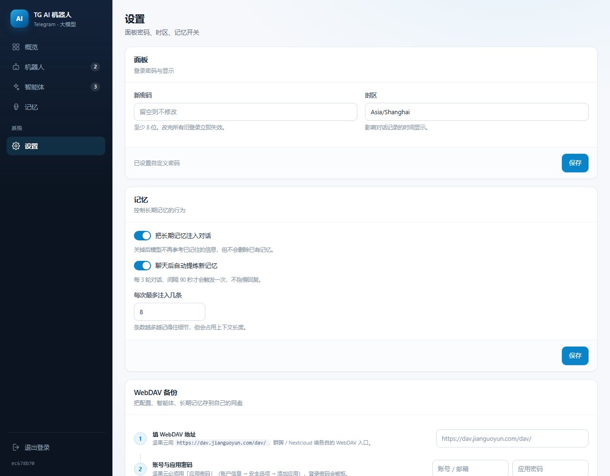

# 升级说明：ec678b7 —— 版本号不再骗人

| 项目 | 内容 |
| --- | --- |
| 提交 | `ec678b70db75119cfe3a93a7d99ee6edb9cb51ea` |
| 上一版本 | `48be170`（群聊上下文隔离 / 回复长度 / 图片理解） |
| 改动规模 | 2 个文件，+15 / −2 行 |
| 类型 | 缺陷修复（可观测性），不改动任何业务逻辑 |
| 升级方式 | 面板「设置 → 在线升级」一键完成，无需重配、无需迁移数据库 |
| 实测结果 | NAS 已运行 `ec678b70`，升级耗时约 4 秒，`pending_restart: false` |

---

## 一句话结论

**这次升级不修任何功能，只修「你看不出来它升了」。**

用户反馈「NAS 上的版本还没升级」，实测 NAS 早已跑在最新提交上——三个新功能的接口全部正常。真正的问题在于：侧边栏和升级卡片里的「当前版本」渲染的是一个**写死的字符串常量**，从项目第一天起就没改过。所以升级一百次，界面都显示 `v1.0.0`，用户唯一能得到的版本体感就是「没变」。

---

## 一、现象

用户原话：「我的 nas 上的版本还没升级，你帮我升上去。」

排查时看到的客观状态，与用户感受完全相反：

| 检查项 | 结果 | 说明 |
| --- | --- | --- |
| `/api/update/status` 的 `commit` | `48be170` | 已是最新提交 |
| `pending_restart` | `false` | 没有「下载完没重启」的残留 |
| `/api/usage` | 200，正常返回 | `9330b69` 新增的用量统计 |
| `/api/backup/status` | 200，正常返回 | `8a0eff2` 新增的 WebDAV 备份 |
| 智能体 `vision` 字段 | 存在，三个均为 `false` | `48be170` 新增，老库迁移成功 |
| 界面「图片理解」开关 | 真实存在于智能体弹窗 | `48be170` 的前端改动已生效 |

也就是说：**功能全在，但用户看不到证据。**

---

## 二、根因

`app/__init__.py` 里这个值从来没有被维护过：

```python
__version__ = "1.0.0"
```

而界面上两处「版本」都直接渲染它：

- 侧边栏底部 `#verLabel`（`app.js` 的 `applyBootstrap`）
- 设置页「在线升级」卡片的「当前版本」`#updVersion`

升级只换代码文件，不动源码里的常量，于是无论升到哪个 commit，`v1.0.0` 岿然不动。同时卡片下方那行「代码提交」显示的却是真实 SHA —— **两行字互相矛盾**，一行像真的、一行像没升，人自然信了不动的那个。

同一个误区的第二个来源：三个智能体的 `max_tokens` 一直是 `300`。上一次把默认值从 `800` 提到 `1600`，只影响**新建**智能体，已有配置不会跟着变。所以回复长度也没变化，进一步强化了「没升级」的判断。

---

## 三、改动内容

### 1. 后端下发真实运行的 commit（`app/main.py`）

`/api/bootstrap` 是面板登录后第一个拉取的接口，在这里补两个字段：

```python
return {
    "version": __version__,
    # 真实在跑的代码版本。__version__ 是写死的发布号，升级多少次都不会变，
    # 拿它当「我有没有升级成功」的判断依据必然看不出变化。这里一并下发 commit。
    "commit": updater.RUNNING_COMMIT,
    "short_commit": updater.RUNNING_COMMIT[:8],
    ...
}
```

关键点在于取的是 `updater.RUNNING_COMMIT`，而不是 `updater.read_state()["commit"]`：

- `read_state()` 里的 commit 在**下载完成那一刻**就被改写，代表「磁盘上是什么」
- `RUNNING_COMMIT` 是模块导入时算的一次快照，代表「进程里真正加载的代码是什么」

两者之间那段不一致的窗口，正好就是「下载完了还没重启」的状态。用它来回答「我到底在跑哪份代码」，才不会骗人。

### 2. 侧边栏改显示短 commit（`app/static/app.js`）

```javascript
state.commit = data.commit || "";
state.shortCommit = data.short_commit || (state.commit ? state.commit.slice(0, 8) : "");

// 侧边栏挂 commit 而不是写死的发布号：升级完能一眼看出代码真的换了。
// 镜像内置代码没有 commit（空串），这时候退回版本号。
var verText = state.shortCommit
  ? state.shortCommit
  : "v" + state.version;
text("verLabel", verText + (state.standby ? " · 值守" : ""));
if (state.commit) $("#verLabel").title = "运行中的代码提交：" + state.commit;
```

- 平时显示 `ec678b70`，鼠标悬停看完整 40 位 SHA
- 值守模式照旧追加 `· 值守`
- Docker 镜像构建出来的副本没有 `.git`，`RUNNING_COMMIT` 是空串，这时自动退回 `v1.0.0`，不会显示成空白

### 3. 升级卡片两行对齐（`app/static/app.js`）

```javascript
// 单看 v1.0.0 永远不变，会让人以为没升级。把在跑的 commit 直接并进版本号。
text("updVersion", (data.short || "镜像内置") + (data.version ? " · v" + data.version : ""));
```

「当前版本」由 `v1.0.0` 变成 `ec678b70 · v1.0.0`，与下面「代码提交」那行不再打架。

### 未改动

- 数据库结构：无新增字段、无迁移
- 所有业务逻辑：`bot.py`、`db.py` 一行没碰
- 升级机制本身：`updater.py` 只被读取，未被修改

---

## 四、验证

三层验证，全部实跑，不是看代码推断。

### 第 1 层：静态校验

确认字段真的下发、前端真的读取：

- `main.py` 含 `"commit": updater.RUNNING_COMMIT` 与 `"short_commit": ...[":8"]`
- `updater` 已在 `main.py` 顶部导入
- `app.js` 含 `state.shortCommit = data.short_commit`、`var verText = state.shortCommit`
- `python -c "ast.parse"` + `node --check` 语法通过

### 第 2 层：本地实例（造数据模拟已升级状态）

在 `127.0.0.1:8144` 起一个 STANDBY 实例，手工写 `update-state.json` 伪造 commit：

```
login        -> 200
bootstrap    -> 200
  version      : 1.0.0
  commit       : 48be170854a856785ad3f018af7519355de429d5
  short_commit : 48be1708
=> PASS
```

再用真实 Edge（CDP）打开面板，确认渲染结果：

- 侧边栏：`48be1708 · 值守`
- 升级卡片：`当前版本 48be1708 · v1.0.0`
- 控制台零报错，排版无重叠、无溢出

### 第 3 层：NAS 生产环境

推送后走面板在线升级 `48be170 → ec678b7`：

| 指标 | 结果 |
| --- | --- |
| 下载文件数 | 22 个 |
| 服务中断 | 约 4 秒 |
| 升级后 `/health` | ok |
| `bootstrap.short_commit` | `ec678b70` |
| `update/status.pending_restart` | `false` |
| `installed_at` | 2026-11-26 05:58:09 |
| 浏览器实测侧边栏 | `ec678b70` |

升级后的实际界面（侧边栏左下角已是 `ec678b70`）：



升级完成后再次核对三个新功能接口，均正常：

```
/api/usage?days=1   -> 200
/api/backup/status  -> 200
/api/ai/agents      -> 200，三个智能体均带 vision 字段
```

---

## 五、升级步骤（下次可复用）

1. 面板 → 设置 → 在线升级 → 点「检查更新」，应看到 `ec678b70` 或更新
2. 点「立即升级」，页面会轮询等待重启，通常 5～15 秒
3. 刷新页面，侧边栏底部应显示短 commit，且与 GitHub 上 `main` 的最新提交一致
4. 若「代码提交」那行显示「xxx（已下载 yyy，待重启）」，说明代码已落盘但进程没重启，再点一次重启即可

**判断升级是否真的生效，只看侧边栏那串短 commit**，不要再看 `v1.0.0`。

---

## 六、仍待处理

| 事项 | 现状 | 建议 |
| --- | --- | --- |
| 三个智能体 `max_tokens` | 均为 `300`（新建默认才是 `1600`） | 手动改成 `1600`～`2048`，否则回复依旧偏短 |
| 三个智能体 `vision` | 均为 `false` | 模型支持多模态时再打开；不支持的打开后会如实报错 |
| `__version__` 常量 | 仍是 `1.0.0` | 已降级为「镜像内置时的兜底显示」，不再作为版本证据 |

前两项属于修改用户数据，未擅自变更。

---

## 七、经验教训

**「版本号」如果是手写常量，就不能作为升级是否生效的证据。**

同类事故这已经是第三次：

1. `e585b9d` —— 在线升级显示成功，实际跑的还是旧代码（假成功）
2. `89cefe2` —— 升级请求发成 GET，405 被当成重启成功（假成功）
3. `ec678b7` —— 升级真的成功了，但界面版本号不动（看不出来）

前两次是「没升却报告升了」，这一次是「升了却看不出来」——同一枚硬币的两面，本质都是**界面展示的状态与真实状态脱钩**。

正确的做法只有两条：

- 判断升级只看「新版本才有的接口 / 字段」，不看任何人工维护的版本字符串
- 或者干脆把真实 commit 打到界面上，让状态无法伪装

现在的实现选择了后者。
